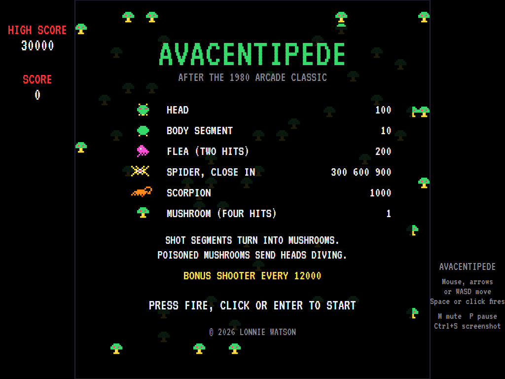
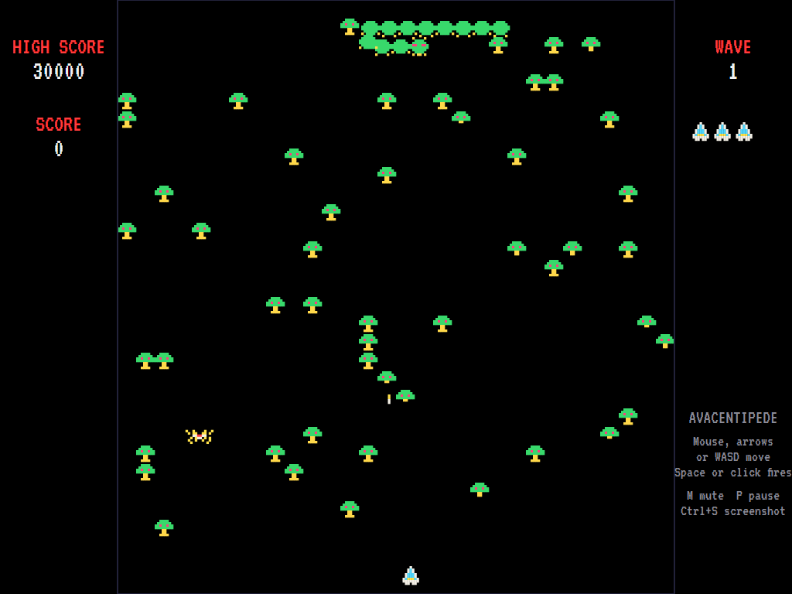
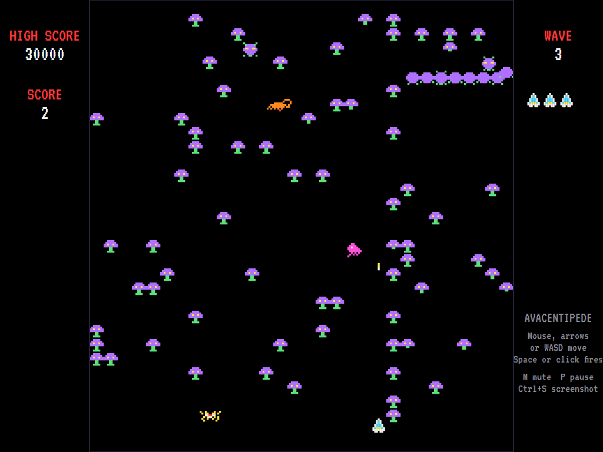
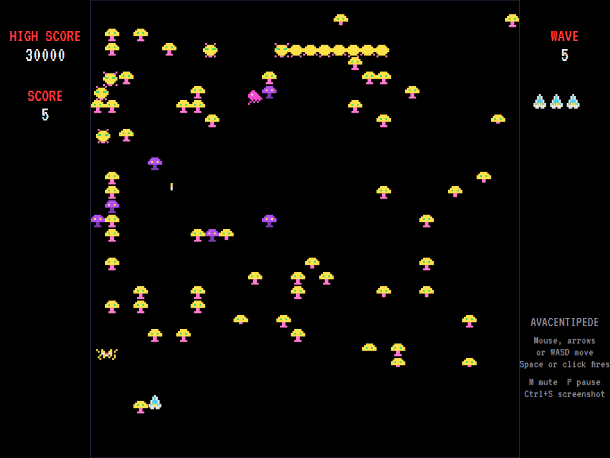
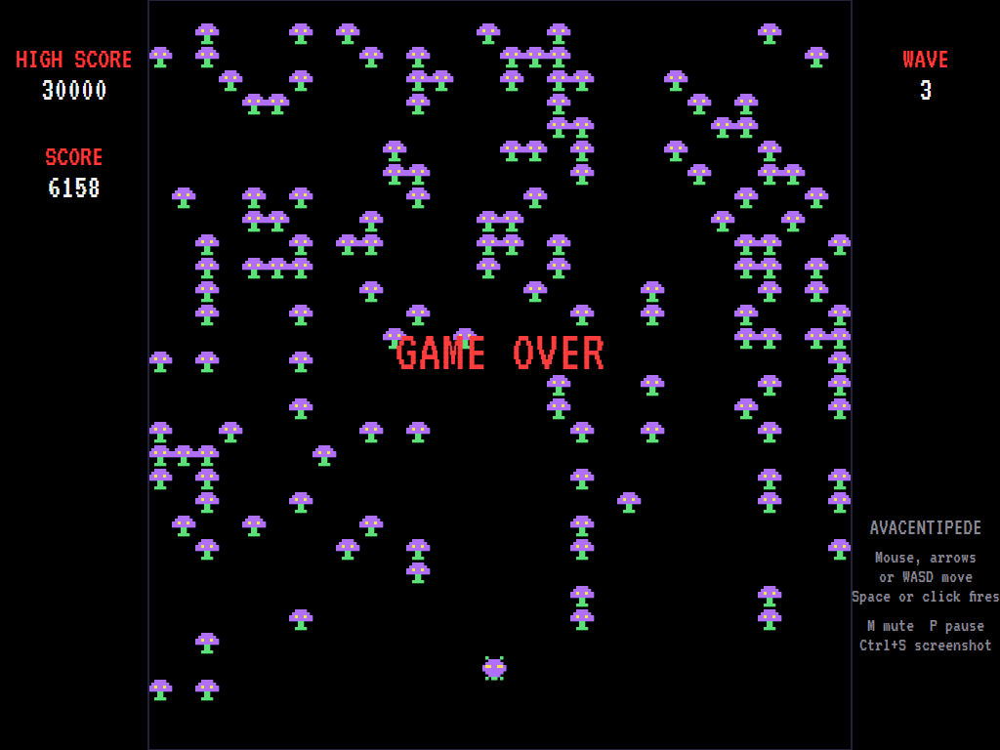
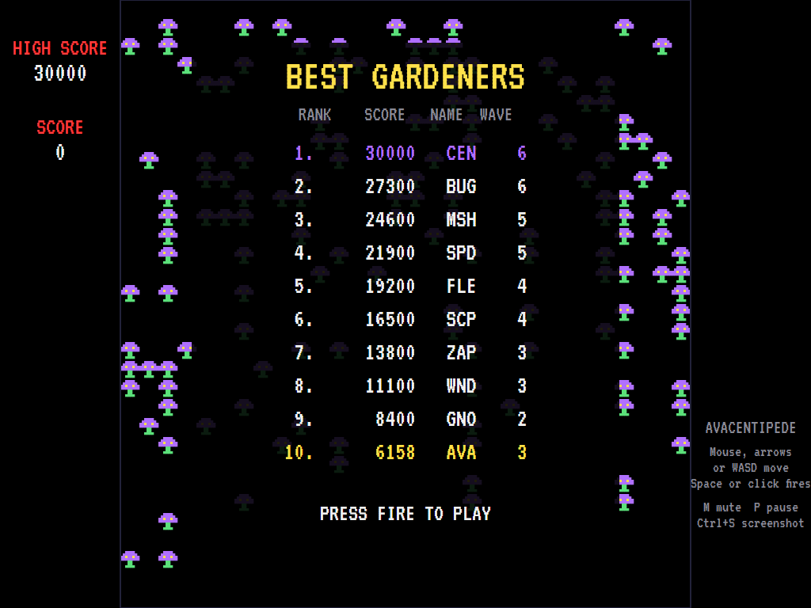

# AVACentipede

[](https://github.com/Harlock123/AVACentipede/actions/workflows/build.yml)

A garden shooter in the style of Atari's 1980 arcade game **Centipede**, built with .NET 10 and Avalonia
UI. A centipede winds down through a field of mushrooms, turning at every mushroom and wall. Shoot a
segment and it becomes a mushroom; the piece behind it grows a head of its own and carries on. Meanwhile
a spider bounces through your corner of the garden, a flea drops in sowing mushrooms, and a scorpion
poisons them so the heads that touch them dive straight for you. Steer with the mouse, as on the arcade's
trackball, or with the keys or a gamepad.

## Features

- **The centipede**: twelve segments that all follow the same rules, so the chain winds as one: along
  the row, and at a mushroom or the wall, down a row and back. At the bottom it works its way back up
  through your zone. Shoot a segment and a **mushroom** grows where it was, and the segment behind it
  becomes a **head**.
- **Waves**: each wave's centipede is one segment shorter, with another **separate head** instead,
  up to six. The fast centipede comes on alternate waves. Once a centipede reaches your zone, more
  heads crawl in from the sides. **Every wave has its own colours.**
- **The mushroom field**: mushrooms take **four shots**, shrinking with each. They're solid: the
  shooter can't pass through them.
- **The flea** (from wave 2) drops straight down when your zone runs short of mushrooms, sowing new
  ones; it takes two hits, and the first only makes it fall faster.
- **The spider** bounces through the bottom of the garden eating mushrooms; shoot it close in for more
  points (**300, 600 or 900**). Touch it and you lose a shooter.
- **The scorpion** (from wave 3) crosses the upper field, **poisoning** every mushroom it passes. A head
  that runs into a poisoned mushroom dives straight to the bottom.
- **Losing a shooter**: the garden is mended (damaged and poisoned mushrooms restored, five points
  each) and the wave starts again from the top.
- **Mouse control like a trackball**: the shooter chases the pointer at speed. Or use the arrow keys,
  WASD or a gamepad. **Hold fire** to fire again the moment your shot lands, as on the arcade.
- **A marching beat** that keeps time while a centipede is on the field, a scurrying title tune, and
  synthesised effects, all mixed by OpenAL.
- **Attract mode**: leave the title alone for 15 seconds and a computer player plays a demonstration,
  with all its sounds.
- **Three shooters**, and another every 12,000 points. **Top-ten high-score table** with arcade-style
  initials entry.
- **Any window size**: the screen scales to fit, letterboxed. **Ctrl+S** saves a screenshot.
- **One self-contained executable** per platform: Windows, macOS and Linux on Intel/AMD and ARM.

All the sprites, sounds and tunes are this game's own.

## Screenshots

| Title screen | The first wave | Spider, flea and scorpion |
|:------------:|:--------------:|:-------------------------:|
|  |  |  |
| The creatures, what they're worth, and how to start. | The centipede winds into the mushroom field. | The scorpion up top, the flea dropping, the spider in the zone. |

| A later wave | Game over | The high-score table |
|:------------:|:---------:|:--------------------:|
|  |  |  |
| Wave 5: new colours, separate heads, and poisoned mushrooms in purple. | The last shooter lost. | The new entry flashes in the table. |

The screenshots are made by the tests, which play the game in a real (headless) window; see
[Tests](#tests).

## Download and run

Ready-to-run builds for Windows, macOS and Linux, on both Intel/AMD and ARM, are on the
[Releases page](https://github.com/Harlock123/AVACentipede/releases/tag/latest). **Latest build** is
rebuilt on every push to `main`. Each download is one self-contained executable: no .NET install is
needed.

| Platform | Archive |
|---|---|
| Windows | `AVACentipede-win-x64.zip`, `AVACentipede-win-x86.zip`, `AVACentipede-win-arm64.zip` |
| macOS | `AVACentipede-osx-arm64.tar.gz` (Apple silicon), `AVACentipede-osx-x64.tar.gz` (Intel) |
| Linux | `AVACentipede-linux-x64.tar.gz`, `AVACentipede-linux-arm64.tar.gz`, `AVACentipede-linux-arm.tar.gz` |

```bash
tar -xzf AVACentipede-linux-x64.tar.gz     # or linux-arm64, linux-arm, osx-arm64, osx-x64
./AVACentipede
```

On Windows, unzip and run `AVACentipede.exe`. On macOS, if Gatekeeper refuses to open it, run
`xattr -d com.apple.quarantine AVACentipede` once. Run with `--no-audio` for silence.

**Sound** comes through OpenAL Soft, built in for every platform. In a virtual machine the game
detects it and uses a larger audio buffer, so the sound doesn't break up.

**Gamepads** use SDL2, which is bundled for Windows, macOS and Intel/AMD Linux. ARM Linux builds need it
installed; without it the mouse and keyboard still work:

```bash
sudo apt install libsdl2-dev            # Debian / Ubuntu / Raspberry Pi OS
sudo pacman -S --needed sdl2-compat     # Arch / Omarchy
```

## Controls

| Input | Action |
|-------|--------|
| **Mouse** | The shooter chases the pointer (a direction key hands control back to the keys) |
| **Left button** | Fire (hold to keep firing) |
| **Arrow keys** / **WASD** | Move |
| **Space** / **Ctrl** | Fire (hold to keep firing) |
| **Enter** | Start a game |
| **P** / **Esc** | Pause (Esc again to quit) |
| **M** | Mute |
| **Ctrl+S** / **Cmd+S** | Save a screenshot to the Pictures folder |

**Gamepad**: the left stick or D-pad moves, **A**, **B**, **X** or the right trigger fires, **Start**
starts and pauses, **Back** (while paused) quits.

**Entering initials**: type letters, or dial with **Up**/**Down** and accept with **Space**; **Left** /
**Backspace** go back; **Enter** finishes.

## Scoring

| Target | Points |
|---|---:|
| Head | 100 |
| Body segment | 10 |
| Flea (two hits) | 200 |
| Spider | 300, 600 or 900, the closer the more |
| Scorpion | 1,000 |
| Mushroom (four hits) | 1 |
| Each mushroom mended after losing a shooter | 5 |

## Tests

```bash
dotnet test AVACentipede.slnx
```

The engine has no UI and runs in fixed 60 Hz steps, so it plays the same at any frame rate, and a seed
always plays the same game. The tests check the centipede's rules (turning at mushrooms and walls,
working back up through the zone, diving at a poisoned mushroom), splitting and the mushroom a shot
segment leaves, the four-shot mushrooms, the flea, the spider's scoring by distance, the scorpion's
poison, mending the garden, the bonus shooters, the shooter's zone and the mouse steering, the waves'
colours and extra heads, the title tune and the demonstration's sound, the high-score table, and every
sound and sprite. A computer player (the attract-mode one) plays whole games in them.

The screenshot tests draw the real screen in a headless window. To refresh the README's pictures:

```bash
CENTIPEDE_SHOTS=$PWD/Images dotnet test tests/AVACentipede.Tests --filter ScreenshotTests
```

## Building

```bash
dotnet build AVACentipede.slnx
dotnet run --project src/AVACentipede
```

Needs the .NET 10 SDK. The sounds are made by `tools/make_sounds.py` (standard-library Python):
`python3 tools/make_sounds.py` rewrites `src/AVACentipede/Sounds`.

## Project structure

```
AVACentipede/
├── AVACentipede.slnx
├── src/AVACentipede/
│   ├── Engine/
│   │   ├── GameEngine.cs        # States, scoring, bonus shooters, the mushroom field
│   │   ├── GameEngine.Play.cs   # The centipede's rules, the shooter and its shot, flea, spider, scorpion,
│   │   │                        # losing a shooter and mending the garden
│   │   ├── Entities.cs          # Segments, the flea, the spider, the scorpion
│   │   ├── AttractPilot.cs      # The computer player for the demonstration (and the tests)
│   │   ├── HighScoreTable.cs, InitialsEntry.cs
│   │   ├── InputHandler.cs, ControllerManager.cs  # Mouse, keys and an SDL2 gamepad
│   │   └── SoundManager.cs      # Effects, tunes and the marching beat through OpenAL
│   ├── Audio/                   # The OpenAL engine (from the author's AVABand)
│   ├── Models/                  # The playfield grid, and the pixel-art sprites and wave colours
│   ├── Views/                   # The screen: the garden, the panels, title and tables
│   └── Sounds/                  # The synthesised effects and tunes
├── tests/AVACentipede.Tests/    # Gameplay and screenshot tests
├── tools/make_sounds.py
└── Images/                      # Screenshots
```

## About and licence

AVACentipede © 2026 Lonnie Watson, under the [MIT License](LICENSE).

*Centipede* © 1980 Atari; the name belongs to its current owner. AVACentipede is an independent,
unofficial game in its style. Its sprites, sounds, tunes and code are its own; nothing is taken from the
arcade machine's program, graphics or sound. It is not affiliated with or endorsed by any rights holder.

Bundled components keep their own licences: the VT323 font (SIL Open Font License 1.1, by Peter Hull;
`src/AVACentipede/Assets/Fonts/VT323-OFL.txt`), OpenAL Soft (LGPL-2.0-or-later; loaded as a separate
library; `src/AVACentipede/Audio/native/COPYING-openal-soft.txt`), and the MIT-licensed Avalonia,
Silk.NET, NVorbis, NLayer and SDL2-CS (with SDL2 under the zlib licence).
